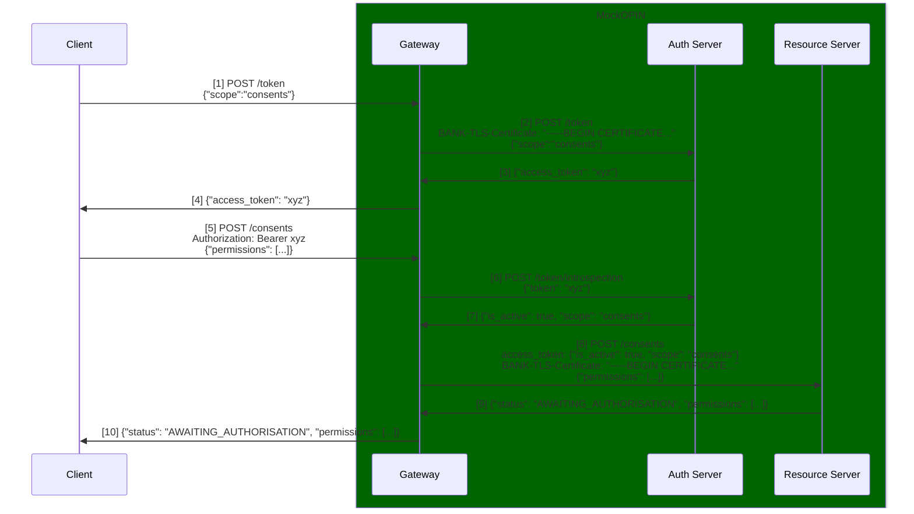

# MockOPIN

This repository provides a fully local instance of **Mock Open Insurance**,
including all components required to comply with Open Insurance (OPIN)
standards and API specifications. It is also the test bed for a doctoral
thesis on migrating the OPIN consent flow from classical to post-quantum
(PQC) and hybrid cryptography.

**Author:** Luciano Figueiredo Coelho | PPGCC/LabSEC/UFSC
**Advisors:** Prof. Ricardo Custódio, Dr. and Prof. Martín Vigil, Dr. — UFSC

**Looking for the thesis results?** Start at
[`thesis/README.md`](thesis/README.md). This project went through three
successive measurement campaigns — **v7** (simulated latency, the
pre-qualification historical baseline), **v8** (real AWS cross-region
latency, additive), and **v9** (a second, independent real-AWS campaign
on a new account, with a corrected OPINsize formula and two supplementary
investigations, "Degrau 1" and "Degrau 2") — see
["Why three campaigns?"](#why-three-campaigns-v7-v8-v9) below for why none
of them is simply discarded in favor of the others.

Certificates for the Certificate Authority and mTLS clients are located in
[`mock-service-os/certs`](./mock-service-os/certs).

## Repository structure

| Path | What it is |
|---|---|
| [`mock-service-os/`](mock-service-os/) | The mock AS, RS gateway (mTLS), and their certificates/keys — the environment the thesis measures |
| [`insurance-server-lambdas/`](insurance-server-lambdas/) | The Resource Server (RS), implemented in Java/Micronaut |
| [`insurance-swagger/`](insurance-swagger/) | OpenAPI/Swagger definitions and codegen templates for the RS |
| [`thesis/`](thesis/) | Thesis automation, experiment data, and results (`v1`–`v9`) — see [`thesis/README.md`](thesis/README.md) |

---

## Table of Contents

- [Why three campaigns? (v7, v8, v9)](#why-three-campaigns-v7-v8-v9)
- [The official v9 campaign: tag, commit, and re-verification](#the-official-v9-campaign-tag-commit-and-re-verification)
- [Prerequisites](#prerequisites)
- [Instructions for macOS / Linux](#instructions-for-macos--linux)
- [Instructions for Windows](#instructions-for-windows)
- [Resuming After a Reboot (already set up)](#resuming-after-a-reboot-already-set-up)
- [Obtaining a Token Using Certificates](#obtaining-a-token-using-certificates)
- [Architecture Design](#architecture-design)
- [Thesis: Post-Quantum Migration](#thesis-post-quantum-migration)
- [License](#license)
- [How to cite](#how-to-cite)
- [Use of Generative AI](#use-of-generative-ai)

---

## Why three campaigns? (v7, v8, v9)

- **v7** — the pre-qualification, **simulated**-latency baseline (`tc`/`netem`
  WAN-latency emulation on one machine). It remains the historical reference
  result and is **not superseded**: see
  [`thesis/results/v7/`](thesis/results/v7/).
- **v8** — the thesis's first **real**-network campaign: the same experiment
  run across real AWS inter-region latency instead of emulated latency.
  **Additive**, not a replacement for v7 — the two measure genuinely
  different things (emulated vs. real WAN conditions). See
  [`thesis/results/v8/`](thesis/results/v8/) and its own `README.md`.
- **v9** — a second, independent real-AWS campaign, on a **new AWS account**,
  that (a) generalizes the orchestrator to more servers/routes, (b) adds a
  fourth, diagnostic-only profile (**Control**), and (c) corrects a
  methodological gap v8 did not have scoped (the internal signature bytes of
  the encrypted `id_token`, see `DECISIONS.md`, Decisions 216-217). v9 also
  includes two supplementary, pre-registered investigations run *after* the
  official campaign closed — **"Degrau 1"** (exploratory root-causing of a
  residual latency gap) and **"Degrau 2"** (a follow-up campaign with
  finer-grained phase timing) — kept in their own subfolders
  (`thesis/results/v9/analise_origem/`, `thesis/results/v9/degrau2/`) and
  never mixed into the official campaign's frozen raw data. See
  [`thesis/results/v9/`](thesis/results/v9/) and its own `README.md` for the
  full breakdown.

In short: **v7 and v8 are both still official**, each for what it measures
(simulated vs. real latency); **v9** is the most recent, most complete real
campaign, and the one with the most extensive engineering/statistical
decision trail.

## The official v9 campaign: tag, commit, and re-verification

The v9 official measurement campaign (the one whose raw data, manifest, and
`PINS.json` are frozen and must never change) is identified by:

- **Tag:** `v9-campanha-oficial-final`
- **Commit:** `c05dcb364192bc193e99704dea2aae5a33b8ae21`

**Important for anyone re-verifying reproducibility or byte-for-byte
integrity of the "frozen" artifacts** (`thesis/results/v9/campaign/PINS.json`,
`thesis/results/v9/campaign_oficial_conta_nova_raw/manifest.sha256`, the
campaign orchestration scripts under `thesis/results/v9/campaign/scripts/`,
and the raw execution data itself): **always diff against commit
`c05dcb36`, never against the current `HEAD`.** Commits after `c05dcb36`
add new, separate work (Degrau 1, Degrau 2, the `id_token` OPINsize
correction) — some of them touch the *same* orchestrator script in a
purely additive way (new optional output fields, nothing removed or
renamed), which means the script's own hash legitimately changes over
time without the already-collected official campaign data changing by a
single byte. `git diff c05dcb36 -- <path>` is the authoritative check for
any file you believe should be frozen.

---

## Prerequisites

To run Mock Insurance OS, ensure the following tools are installed:

- **Java 17**
- **Gradle**
- **Docker**

---

Below are the steps to run and interact with Mock OPIN on your local machine.

If you're using macOS or Linux, refer to the [Instructions for macOS / Linux](#instructions-for-macos--linux).

If you're using Windows, refer to the [Instructions for Windows](#instructions-for-windows).


## Instructions for macOS / Linux

The following instructions cover how to run and interact with Mock OPIN on macOS or Linux, as well as how to configure and execute it together with the Conformance Suite.

### 1. Setup

Publish the local dependency that contains the API models used by Mock Insurance.

> This step is required only once.

```bash
make setup
```

### 2. Configure Local Hosts

Add the following entries to your hosts file to create aliases for localhost:

```bash
127.0.0.1 auth.local
127.0.0.1 api.local
127.0.0.1 directory
```

### 3. Run the Environment

To run a fully local instance, start all components using Docker:

```bash
make run
```

### 4. Run with Conformance Suite

To run a fully local instance with the Conformance Suite, you need to start all components, along with the Conformace Suite itself.

1. Run the command below to set up the Conformance Suite:

   ```bash
   make setup-cs
   ```

2. Then start the environment with:

   ```bash
   make run-with-cs
   ```

3. Once running, you can access the environment via:

   ```
   https://localhost:8443
   ```

Configuration for the tests is available in the `cs_config.json` file.

---

## Instructions for Windows

> ⚠️ These instructions assume you're using a Linux-compatible terminal such as **WSL** (Windows Subsystem for Linux) or **Git Bash**.

The following instructions cover how to run and interact with Mock OPIN on Windows, as well as how to configure and execute it together with the Conformance Suite.

### 1. Setup

Publish the local dependency that contains the API models used by Mock Insurance.

> This step is required only once.

```bash
make setup
```

### 2. Configure Local Hosts

Add the following entries to your hosts file to create aliases for localhost:

```bash
127.0.0.1 auth.local
127.0.0.1 api.local
127.0.0.1 directory
```

### 3. Run the Environment

To run a fully local instance, start all components using Docker:

```bash
make run
```

Wait for the containers to be fully initialized, then stop them before continuing to the next step.

### 4. Modify the Makefile in Order to Run with Conformance Suite

1. In the root `Makefile`, locate the `setup-cs` section, related to cloning the Conformance Suite repository and initial setup, and do the following:

   - **Comment out** line 15 (which builds the Conformance Suite)
   - **Keep only** lines 11, 12, and 13 in `setup-cs`

2. Save the file, then run:

   ```bash
   make setup-cs
   ```

3. Edit the same `Makefile` again:
   - **Uncomment** line 15
   - **Comment out** lines 11, 12, and 13 (to avoid re-downloading)

4. Save and run the command again to set up the conformance suite:

   ```bash
   make setup-cs
   ```

### 5. Run with Conformance Suite

1. Then start the environment with:

   ```bash
   make run-with-cs
   ```
   
2. Once running, you can access the environment via:

   ```
   https://localhost:8443
   ```

Configuration for the tests is available in the `cs_config.json` file.

### 6. (Optional) Fix Dockerfile Issues
In some environments, Docker may fail to locate the `buster` image. If this occurs:

1. Edit the following three `Dockerfile` files inside the `conformance-suite` folder as it follows:
   - 
   - 
   - 
2. Ensure they are pointing to valid base images (e.g., replace `buster` with an available image that matches your environment).
3. Return to step [5. Run with Conformance Suite](#5-run-with-conformance-suite)

---

## Resuming After a Reboot (already set up)

If you already went through `make setup`, `make setup-cs`, and `make run-with-cs` at least once, everything needed survives a reboot: Docker images, volumes (`mongo-data`, `maven-cache`, `config`), the cloned + built `conformance-suite/` (including its `target/fapi-test-suite.jar`), the generated certificates, and the `auth.local` / `api.local` / `directory` hosts file entries. None of that needs to be redone.

Only the running containers stop. To bring everything back up:

1. Make sure Docker Desktop is running.
2. From the repository root:
   ```bash
   make run-with-cs
   ```
   This rebuilds the `insurance-server-lambdas` image (fast — Gradle cache) and starts every container. No re-clone or Conformance Suite rebuild happens unless you deleted `insurance-server-lambdas/conformance-suite/`.
3. If you only need the base environment (no Conformance Suite), use `make run` instead.

**Known race condition on cold start:** `auth` and `mtls` depend on `localstack` being healthy, but the healthcheck (presence of `config.txt`) can pass slightly before `localstack` finishes provisioning all SSM parameters and S3 objects (`setup_ssm.sh`). On a full cold start this sometimes makes `auth` and/or `mtls` exit with an error (`ParameterNotFound`, `Could not fetch ssa_jwk from S3`). If that happens, just restart the two once `localstack` has settled:
```bash
docker-compose up -d auth mtls
```
Verified: on a full stop → cold start test, this raced and failed once, and came back clean immediately on that one retry — it isn't a real configuration problem, just startup ordering.

If `insurance-server-lambdas/conformance-suite/` was deleted or you're setting up on a **new machine**, you also need to reapply the local-Directory patches described in [`thesis/patches/README.md`](thesis/patches/README.md) — the Conformance Suite otherwise tries to validate against Raidiam's real sandbox Directory and fails. Apply those patches, then run `make setup-cs` (both phases, see [Instructions for Windows](#instructions-for-windows) step 4) before `make run-with-cs`.

---

## Obtaining a Token Using Certificates

To request a token using the client certificate:

```bash
curl -v \
  --cert ./mock-service-os/certs/client_one.crt \
  --key ./mock-service-os/certs/client_one.key \
  --cert-type PEM \
  --key-type PEM \
  -u client:1234 \
  -d "grant_type=client_credentials&scope=openid" \
  -H "Content-Type: application/x-www-form-urlencoded" \
  https://auth.local/token -k
```

To introspect the token:

```bash
curl -v \
  --cert ./mock-service-os/certs/client_one.crt \
  --key ./mock-service-os/certs/client_one.key \
  --cert-type PEM \
  --key-type PEM \
  -u client:1234 \
  -d "token=your_access_token" \
  -H "Content-Type: application/x-www-form-urlencoded" \
  https://auth.local/token/introspection -k
```

## Architecture Design

The system is composed of three main components: the Authorization Server (AS), the Resource Server (RS), and the Gateway (GW), which together form the MockOPIN architecture.

### Gateway

Implemented in Go under mock-service-os/mock_mtls, the gateway intercepts all incoming requests.

It is responsible for:
* Handling mTLS connections.
* Extracting and forwarding client certificate details.
* Introspecting access tokens via the Authorization Server.
* Forwarding validated requests to secured endpoints on behalf of the client.

### Authorization Server

Located at mock-service-os/mock_as, this Node.js service leverages the node-oidc-provider library.

Its primary responsibilities include:
* Managing OAuth2/OpenID Connect logic.
* Handling client registration, user authentication, and token issuance.
* Exposing the /token, /introspection, and related endpoints.

### Resource Server
Implemented in Java (Micronaut) under insurance-server-lambdas, the Resource Server exposes the Open Insurance API endpoints.

It:
* Consumes access tokens received from the gateway.
* Enforces scope-based authorization.
* Executes the business logic for endpoints such as /consents, /customers, and /policies.

### End-to-End Consent Creation Flow

The following diagram illustrates the detailed flow for creating a consent in the MockOPIN architecture:



1. The client establishes an mTLS connection and requests a token:
   ```
   POST matls-auth.local/token
   ```
   ```json
   {
      "client_assertion": "ey...",
      "client_assertion_type": "urn:ietf:params:oauth:client-assertion-type:jwt-bearer",
      "grant_type": "client_credentials",
      "scope": "consent"
   }
   ```

2. The Gateway intercepts the connection, extracts the certificate, and forwards it to the Authorization Server:
   ```
   POST auth:3000/token
   BANK-TLS-Certificate: -----BEGIN CERTIFICATE...
   X-BANK-Certificate-DN: ...
   X-BANK-Certificate-Verify: SUCCESS
   ```
   ```json
   {
      "client_assertion": "ey...",
      "client_assertion_type": "urn:ietf:params:oauth:client-assertion-type:jwt-bearer",
      "grant_type": "client_credentials",
      "scope": "consent"
   }
   ```

3. The Authorization Server validates the request and issues an access token:
   ```json
   {
      "access_token": "xyz",
      "expires_in": 3600,
      "token_type": "bearer"
   }
   ```

4. The Gateway forwards the response back to the client unchanged.

5. The client then makes a new mTLS request to create a consent:
   ```
   POST matls-api.local/open-insurance/consents/v2/consents
   Authorization: Bearer xyz
   ```
   ```json
   {
      "permissions": [],
   }
   ```

6. The Gateway introspects the access token with the Authorization Server:
   ```
   POST auth:3000/token/introspection
   ```
   ```json
   {
      "token": "xyz"
   }
   ```

7. The Authorization Server responds with the token status:
   ```json
   {
      "is_active": true,
      "scope": "consents"
   }
   ```

8. The Gateway forwards the validated token content and client certificate to the Resource Server:
   ```
   POST mockapi:8080/token
   BANK-TLS-Certificate: -----BEGIN CERTIFICATE...
   X-BANK-Certificate-DN: ...
   X-BANK-Certificate-Verify: SUCCESS
   access_token: {"is_active":true,"scope":"consents"}
   ```
   ```json
   {
      "permissions": [],
   }
   ```

9. The Resource Server processes the request, authorizes based on the token scope, and responds.
   ```json
   {
      "status": "AWAITING_AUTHORISATION",
      "permissions": []
   }
   ```

10. The Gateway forwards the final response to the client unchanged.
   ```json
   {
      "status": "AWAITING_AUTHORISATION",
      "permissions": []
   }
   ```

### Cloud Architecture
Although the project was originally designed and deployed on AWS, its components are largely cloud-agnostic and can be adapted to other providers (such as Azure) with minimal changes.

The primary cloud-specific dependency is how the Authorization Server retrieves its configuration parameters.
In the current implementation, configuration is fetched from AWS SSM Parameter Store, as defined in: `mock-service-os/mock_as/express.js`.

For local development, this behavior is replicated using LocalStack, provisioned via `mock-service-os/setup_ssm.sh`.

When deploying to another cloud provider, the only required adjustment is replacing the SSM parameter-loading logic with that provider’s equivalent service (e.g., Azure App Configuration, GCP Secret Manager, or simple environment variables).

---

## Thesis: Post-Quantum Migration

This environment is also the test bed for a doctoral thesis measuring the
cost of migrating the OPIN consent flow above to post-quantum (PQC) and
hybrid cryptography — the same gateway, AS, and RS described above, run
under three (v7/v8) or four (v9, which adds a diagnostic-only **Control**
profile) cryptographic profiles that vary only the TLS key exchange and
the signature/certificate scheme.

- **Start here:** [`thesis/README.md`](thesis/README.md)
- **v7 (simulated latency, historical baseline):** [`thesis/results/v7/`](thesis/results/v7/)
- **v8 (first real-AWS campaign, additive):** [`thesis/results/v8/`](thesis/results/v8/)
- **v9 (second, independent real-AWS campaign — most recent, most complete):**
  [`thesis/results/v9/`](thesis/results/v9/) — see `Consolidated_Metrics_Report_FINAL.md`
  for the numbers, `DECISIONS.md` for the full engineering/statistical
  decision trail (every methodological deviation, correction, and
  independent audit along the way), and the
  [tag/commit/re-verification note above](#the-official-v9-campaign-tag-commit-and-re-verification).

## License

This repository is under the [MIT License](LICENSE), inherited from the
upstream fork this project started from
([`br-openinsurance/MockOPIN`](https://github.com/br-openinsurance/MockOPIN) /
Raidiam's Open Insurance Brasil mock service). The `LICENSE` file's copyright
line ("Open Insurance Brasil") reflects that upstream origin, not this
thesis's own additions specifically — see `CITATION.cff` for a `# TODO` note
on this point.

## How to cite

See [`CITATION.cff`](CITATION.cff) for the machine-readable citation record.
Several fields there (the final thesis title, version/release, DOI) are
marked `# TODO` pending confirmation — check the file directly before citing.

## Use of Generative AI

During this work, Anthropic's Claude Sonnet 5 was used as an assistant,
through Claude Code, between July 2026 and November 2026. It was used to
write and review the code of the
experimental environment and of the analysis scripts, to run consistency
checks of the results against the raw data, and to draft and revise the text
of the documentation. The architecture of the experiment, the research
questions, the experimental design, the hypotheses, the choice of metrics
and scope, and the interpretation of the results were defined by the author
together with the advisors, who also made the main decisions of the work.
All the material produced with the tool was reviewed by the author, who is
responsible for the content of this work. The work belongs to the author and
his advisors.
